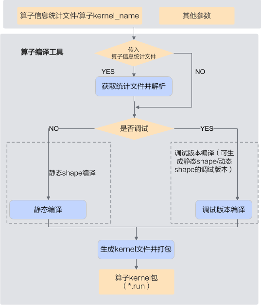
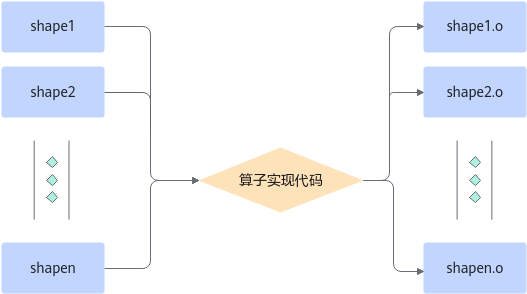
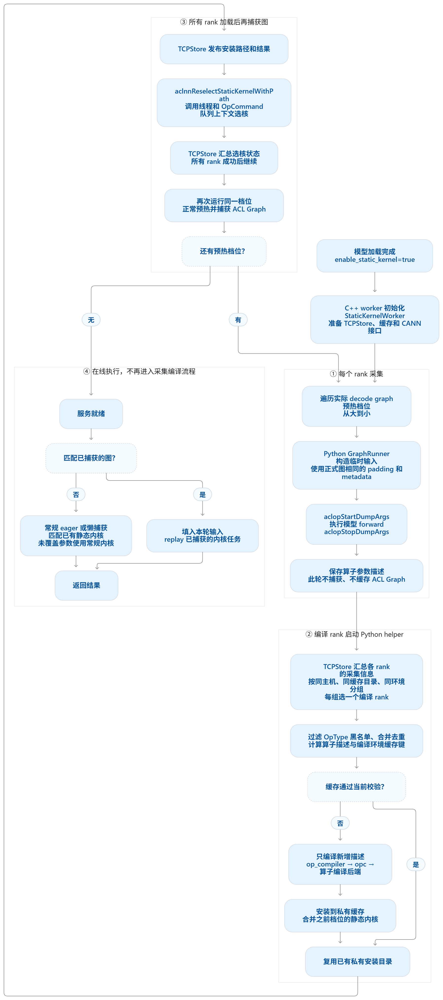
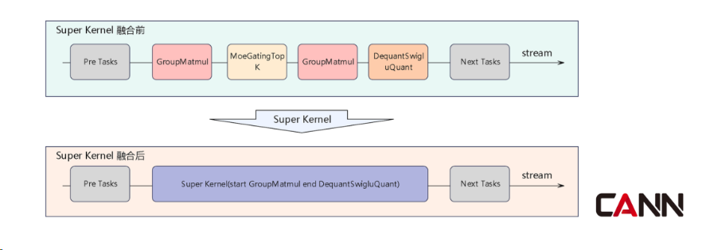
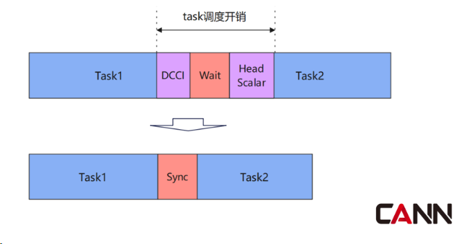
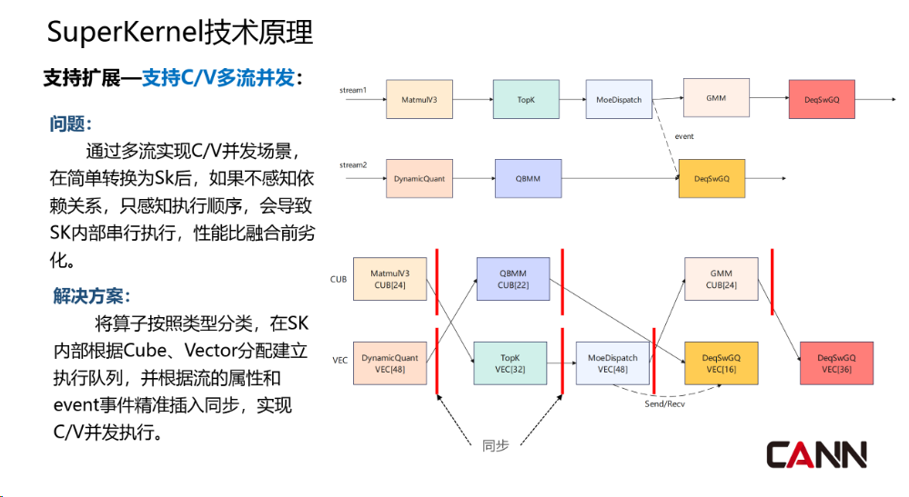

# Statickernel原理与xLLM适配介绍

## 1. AOT和JIT
AOT（Ahead-of-Time，提前编译）和 JIT（Just-in-Time，即时编译）描述的是**编译发生的时机**，而不是 Kernel 是否针对固定 Shape 优化。

### 1.1 AOT

AOT 是在正式执行计算之前完成编译，运行时直接加载已有的二进制产物。

典型流程：

```text
算子源码或可编译实现
        ↓ 安装、模型部署或服务启动前编译
Kernel 二进制
        ↓ 正式运行时加载
执行计算
```

例如，自定义 Ascend C 算子在工程构建阶段生成 `.o`、`.json` 等文件，并打包成自定义 OPP 安装包，之后由推理程序加载执行，这属于 AOT。

AOT 的主要特点是：

- 正式运行时通常不需要重新调用编译器；
- 启动和运行行为更容易预测；
- 编译失败可以尽早暴露；
- 便于随安装包、容器镜像或发布产物统一分发。

### 1.2 JIT

JIT 是在程序运行过程中，根据本次调用获得的信息现场编译，然后加载并执行。

典型流程：

```text
程序执行到某个 Kernel
        ↓
获得本次 Shape、dtype、模板参数等信息
        ↓
现场编译生成 Kernel 二进制
        ↓
执行并缓存，后续相同参数可复用
```

Triton 的 `@triton.jit` 是典型例子。Ascend C 也提供 RTC（Runtime Compiler）能力，可以通过 `aclrtc` 接口在程序运行时将 Kernel 源码编译为 Device 机器码，再加载执行。

JIT 的主要特点是：

- 可以利用本次调用才确定的信息进行特化；
- 不必提前穷举所有参数组合；
- 需要处理首次编译延迟、编译器依赖和缓存管理；
- 如果参数组合持续变化，可能产生大量 Kernel 变体。

### 1.3 运行时动态适配不等于 JIT

普通 Ascend C 算子可能在 Host 侧根据真实 Shape 计算 TilingData，再把每个核处理多少数据、Tile 大小、循环次数和尾块大小等传给一个提前编好的通用 Kernel。

这条路径是：

```text
提前编译好的动态 Kernel + 运行时 Host Tiling
```

虽然 Shape 是运行时确定的，但只要没有现场重新生成机器码，就仍然不是 JIT。

---

## 2. Static Kernel
Static Kernel 通常是指：**Shape 等部分算子参数在编译期固定，并参与 Kernel 代码生成和优化。**

例如，编译器明确知道：

- 输入 Shape 为 `[8, 128]`；
- 数据类型为 `float16`；
- Format 为 `ND`；
- 某些循环次数、Tile 大小或模板参数已经固定。

编译器因此可能进行常量传播、分支消除、循环展开、固定地址计算或其他针对性优化。

这里的 Static **不是指编译时机**，也不是说 Tensor 的数据地址和数据内容固定。输入输出地址及实际数据仍然可以在运行时变化。

与 Static Kernel 相对，动态 Kernel 可以将 Shape 保留为运行时参数。例如，Shape 被写入 TilingData，Kernel 执行时再读取：

```text
Host 读取 Shape → 计算 TilingData → Device Kernel 运行时读取
```

这种实现具有良好的动态适配能力，但 Device 编译器在编译时看不到具体 Shape，能够进行的 Shape 常量优化相对有限。

## 3. op_compiler -- statickernel编译命令行工具
CANN 的 `op_compiler` 算子编译工具可以读取之前从实际执行场景 Dump 出的算子信息，根据其中的 Shape、dtype、Format 和 SoC 等信息，提前编译并安装 Static Kernel。

典型流程：

```text
第一次运行或 Profiling
        ↓
Dump 算子 Shape、dtype、Format 等实际信息
        ↓
生成 Dump JSON
        ↓
正式部署前执行 op_compiler
        ↓
生成并打包 Static Kernel，安装到 opp/static_kernel
        ↓
正式运行时按实际参数匹配并加载
```



由于编译发生在正式运行之前，所以通过 `op_compiler` 生成 Static Kernel 的流程属于 **AOT**。

但它与普通的“只根据源码做 AOT”略有不同：它利用了上一次实际运行时收集的参数信息。其思路类似于 Profile-Guided Optimization：

> 信息来自运行时，但利用这些信息进行的编译发生在后续正式运行之前，因此仍然是 AOT，而不是 JIT。



## 4. 实例：Matmul 如何静态化 Tiling 并利用常量优化

Ascend C 的 `matmul_aot_compilation` 示例完整展示了上述过程。它不是只把 `M/N/K` 写成常量，而是把指定 Shape 对应的**完整 `TCubeTiling`** 固化到一个专用 Kernel 中，同时保留通用 Kernel 兜底。

### 4.1 通用版本：Tiling 是运行时数据

Matmul 的 Host Tiling 根据 Shape、核数和硬件约束生成 `TCubeTiling`。示例规格为 `M=512, N=512, K=128`，生成的部分关键参数为：

```text
M = 512
N = 512
Ka = Kb = 128

usedCoreNum = 2
singleCoreM = 256
singleCoreN = 512
singleCoreKa = 128
singleCoreKb = 128
……其他 Matmul 分块和控制参数
```

通用 Kernel 通过函数参数接收 Tiling：

```cpp
__global__ __cube__ void matmul_custom(
    __gm__ uint8_t* a,
    __gm__ uint8_t* b,
    __gm__ uint8_t* c,
    TCubeTiling tilingInput)
{
    // tilingInput.M、tilingInput.singleCoreM 等都是运行时值
}
```

编译这份通用 Kernel 时，编译器不知道矩阵规格、核间切分、内部循环次数以及哪些 Tiling 分支会执行，因此只能保留相应的运行时读取、计算和判断。

### 4.2 第一步：取得并固化完整 Tiling

示例先针对 `512×512×128` 正常执行一次 Host Tiling：

```cpp
tilingApi.SetOrgShape(512, 512, 128);
tilingApi.SetShape(512, 512, 128);
tilingApi.GetTiling(tilingData);
```

随后将生成的 `TCubeTiling` 按内存字节打印出来，保存成编译期数组：

```cpp
static constexpr uint8_t AOT_MatmulTiling_512x512x128_Value[] = {
    0x02, 0x00, 0x00, 0x00,
    0x00, 0x02, 0x00, 0x00,
    // ...
};
```

这里保存的不只是 `M/N/K`，还包括核数、每核处理规模、Matmul 内部基础块大小以及其他控制字段。

再通过 `AOTHolder` 在编译期将字节恢复成常量结构体：

```cpp
template <typename T, const uint8_t* ValuePtr>
struct AOTHolder {
    static constexpr const uint8_t* value_ptr = ValuePtr;
    static constexpr const T value = convert_from_bytes<T>(ValuePtr);
};
```

因此，下面的 `value` 就是一个编译期可见的 `TCubeTiling` 常量：

```cpp
AOTHolder<TCubeTiling, AOT_MatmulTiling_512x512x128_Value>::value
```

### 4.3 第二步：由同一份源码实例化通用和专用 Kernel

示例将 Kernel 写成模板，通过 `TH` 区分 Tiling 的来源：

```cpp
template <typename TH>
__global__ __cube__ void matmul_custom(
    __gm__ uint8_t* a,
    __gm__ uint8_t* b,
    __gm__ uint8_t* c,
    __gm__ uint8_t* workspace,
    TCubeTiling tilingInput)
{
    const auto& tiling =
        aot::GetHolderDataRef<TCubeTiling, TH>(tilingInput);

    // 后续 Matmul 代码统一使用 tiling
}
```

`GetHolderDataRef` 在编译期选择数据来源：

```cpp
if constexpr (std::is_same_v<HT, RuntimeHolder<T>>) {
    return rt_data;   // 通用版本：读取运行时 TilingData
} else {
    return HT::value; // AOT 版本：读取编译期常量
}
```

于是，同一份源码生成两种 Kernel：

```text
matmul_custom<RuntimeHolder>
    tiling = tilingInput
    Shape 和分块参数都是运行时变量
    → 通用版本

matmul_custom<AOTHolder<512×512×128>>
    tiling = constexpr TCubeTiling
    Shape 和分块参数都是编译期常量
    → 512×512×128 专用版本
```

AOT 版本虽然仍保留 `tilingInput` 函数参数，但实际使用的是 `TH::value`。

### 4.4 第三步：编译器利用静态 Tiling 优化

#### 常量传播和地址计算简化

通用版本中的输入 A 长度计算为：

```cpp
aGlobal.SetGlobalBuffer(
    reinterpret_cast<__gm__ half*>(a),
    tiling.M * tiling.Ka);
```

通用 Kernel 需要读取 `tiling.M`、`tiling.Ka` 后再做乘法。专用版本中，编译器看到的是：

```cpp
512 * 128
```

可以直接折叠为 `65536`。

输入 A 的核偏移原为：

```cpp
GetBlockIdx() * tiling.singleCoreM * tiling.Ka
```

静态化后等价于：

```cpp
GetBlockIdx() * 256 * 128
```

可进一步折叠为：

```cpp
GetBlockIdx() * 32768
```

这样可以减少运行时读取 Tiling 字段和标量计算的开销。

#### 为循环展开和指令调度提供条件

通用版本中：

```cpp
mm.SetOrgShape(
    tiling.M,
    tiling.N,
    tiling.Ka,
    tiling.Kb);
```

专用版本中等价于：

```cpp
mm.SetOrgShape(512, 512, 128, 128);
```

同时，Matmul 内部使用的 `singleCoreM/N/Ka/Kb` 和其他分块参数也都是常量。编译器由此可以获得确定的循环边界和地址步长，有机会进行：

- 部分循环展开；
- 循环控制及尾部分支简化；
- 地址步长提前计算；
- 更合适的 Cube 指令和数据搬运调度。

这里是为编译器**提供优化条件**，具体是否完全展开某个循环仍取决于编译器实现和代码复杂度。

#### 死代码消除

假设 Matmul 内部存在：

```cpp
if (tiling.someMode == 1) {
    // 路径 A
} else {
    // 路径 B
}
```

通用版本必须保留判断和两条路径；专用版本如果编译期知道 `tiling.someMode == 1`，就可以只保留路径 A，删除路径 B 和相应判断，从而减少指令数量并可能降低 ICache 压力。

### 4.5 第四步：运行时匹配专用版本，未命中则回退

示例运行时仍执行 Host Tiling：

```cpp
GenerateTiling(..., tiling);
uint32_t numBlocks = tiling.usedCoreNum;
```

然后由 `AOTDispatcher` 将运行时 Tiling 与注册的常量逐字节比较：

```cpp
std::memcmp(
    runtimeTiling,
    Holder::value_ptr,
    sizeof(TCubeTiling)) == 0;
```

选择逻辑为：

```text
运行时 Tiling == 注册的 512×512×128 完整 Tiling
        → 调用 matmul_custom<AOTHolder<...>>
        → 使用静态化 Tiling 的专用 Kernel

不完全相同
        → 调用 matmul_custom<RuntimeHolder>
        → 使用通用 Kernel 兜底
```

比较整个 Tiling 而不是只比较 `M/N/K`，是因为即使 Shape 相同，SoC 架构、数据类型、Format、核数、Tiling 算法配置或 CANN 版本不同，也可能生成不同的 Tiling。

## 5. Static Kernel特性适用范围
`op_compiler` 是 CANN 算子的编译调度、打包工具，所以它底层对接的编译器直接决定哪些算子能适配Static Kernel特性。理论上`具有 CANN 编译注册入口的 AI Core 算子`都可以使能Static Kernel。主要覆盖 AscendC 和 TBE（DSL/TIK）算子。所以自定义的AscendC和TBE算子理论上也是可以使能static kernel的。

## 6. xLLM适配过程


### 性能收益 Qwen3.5-35B  TP=2 BF16

| 算子 | Static OFF | Static ON | 耗时降低 |
|---|---:|---:|---:|
| MatMulV2 | 10.466 μs | 7.106 μs | **32.1%** |
| GroupedMatmul | 23.514 μs | 21.125 μs | **10.2%** |
| MoeInitRoutingV3 | 10.594 μs | 5.331 μs | **49.7%** |
| MoeGatingTopKSoftmaxV2 | 4.862 μs | 3.037 μs | **37.5%** |
| MoeFinalizeRoutingV2 | 5.654 μs | 3.785 μs | **33.1%** |
| GammaAddRmsNorm | 2.194 μs | 1.965 μs | **10.5%** |
| SwiGlu | 3.442 μs | 2.979 μs | **13.4%** |
| Add | 1.617 μs | 1.234 μs | **23.7%** |
| Mul | 1.394 μs | 1.076 μs | **22.8%** |
| Sigmoid | 1.095 μs | 1.009 μs | **7.9%** |
| GemmaRmsNorm | 4.040 μs | 3.932 μs | **2.7%** |

## 7. SuperKernel

https://cann.csdn.net/69e983d00a2f6a37c5a1c0db.html

SuperKernel是一种算子二进制融合技术。与源码融合不同，它聚焦于内核函数（Kernel）的二进制调度方案优化，在已编译的二进制代码基础上融合创建一个超级Kernel函数（简称SuperKernel），以子函数调用的方式整合多个内核函数，从而优化计算任务、提升性能和资源利用率。

与单算子下发相比，SuperKernel技术能够优化任务调度的等待时间和调度开销，并可利用Task间隙资源进一步优化算子头开销。

SuperKernel的实现原理如下：

基于aclgraph捕获后的Model，SuperKernel模块识别可被融合的连续Task，将其合并为一个SuperKernel Task并替换原有Task，通过Runtime接口更新Model后基于新Model执行。

开启SuperKernel融合优化后，系统自动识别图内可被融合的算子，在SuperKernel内以子函数调用的方式依次执行。同时提供标定SuperKernel范围的能力，支持用户根据实际业务需求对融合范围内的算子进行标记和优化配置。

SuperKernel融合会按照网络中算子的顺序依次判断是否可被融合。当识别到不可融合的算子时，系统会生成第一段SuperKernel，并自动跳过该算子进行第二段SuperKernel融合。

### 7.1 启动头开销




### 7.2 CV优化


