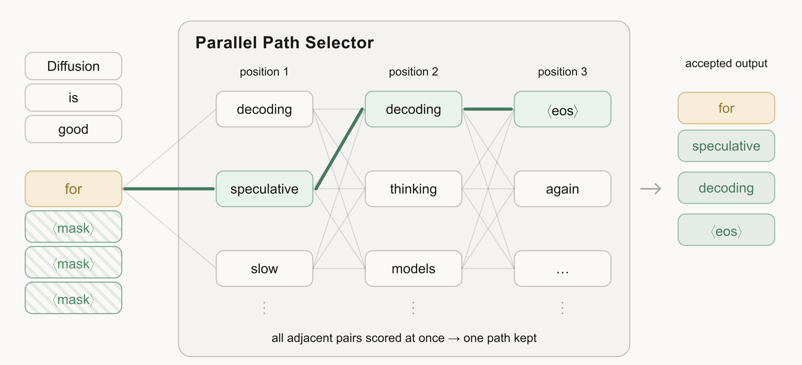
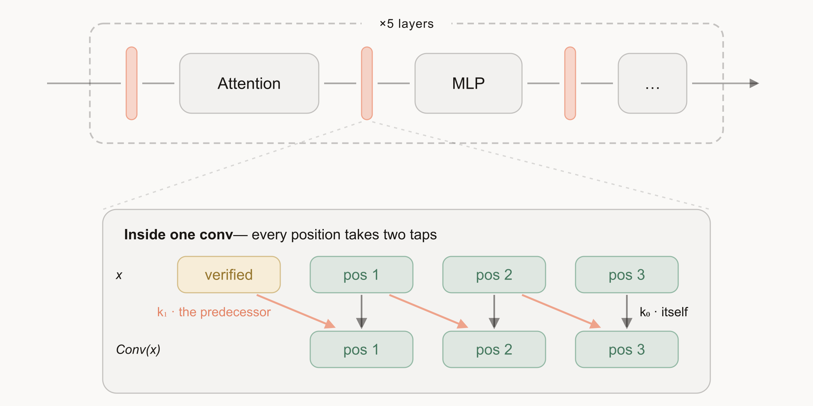
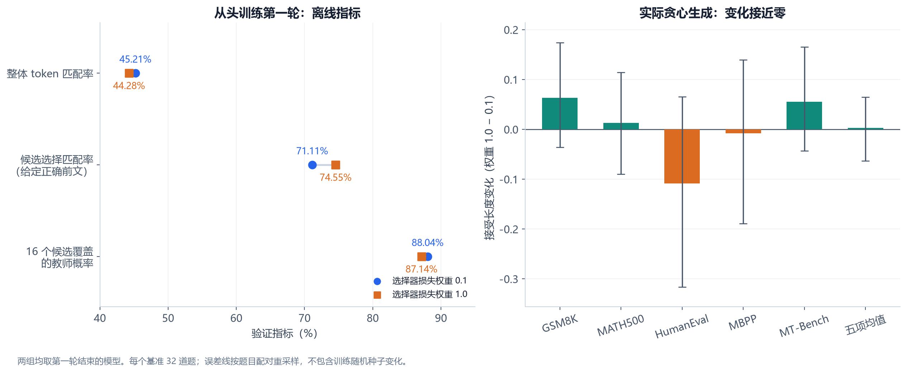
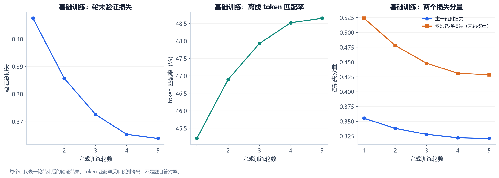
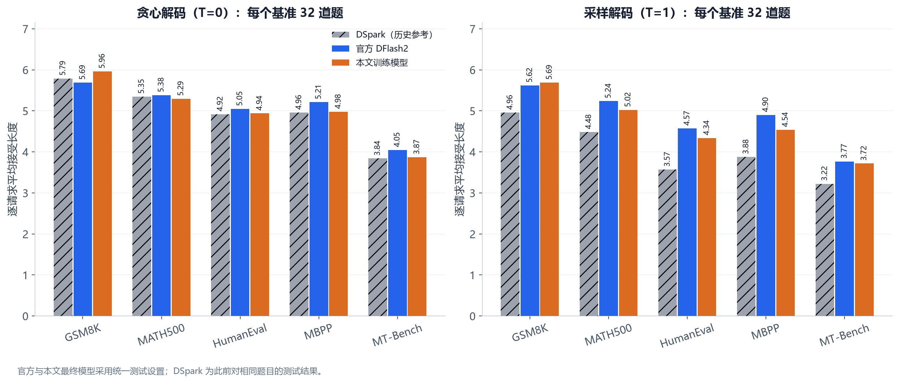
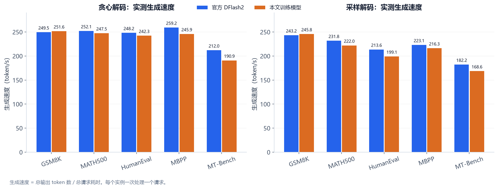
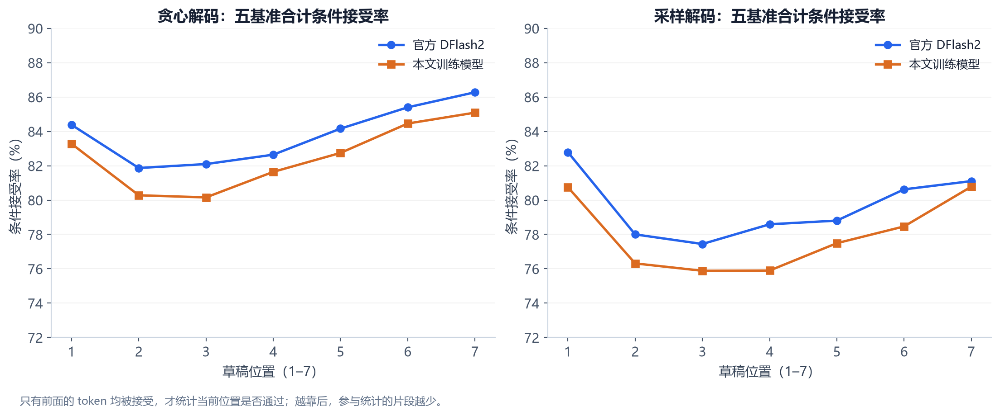
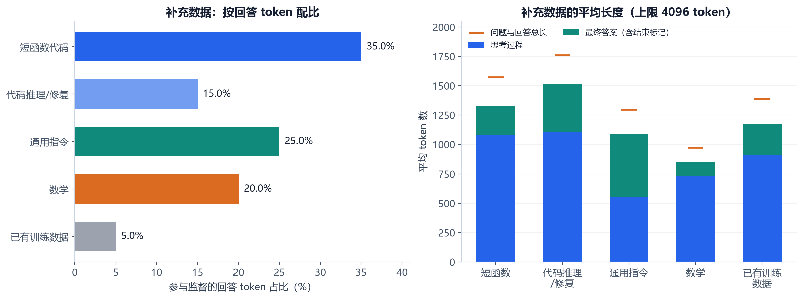
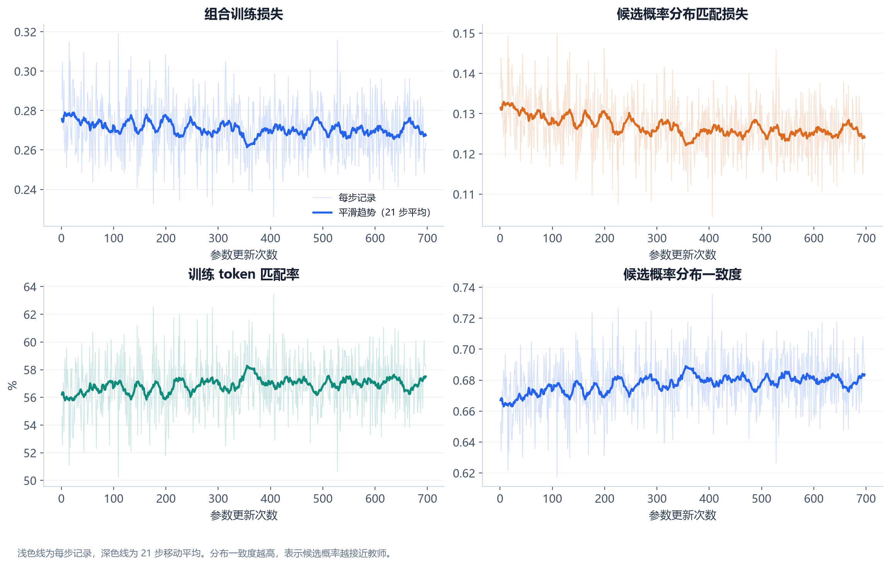

# Qwen3.8-27B的DFlash2训练实践：开放数据、训练配方与推理加速

基于公开实现和开放数据，我们完成了Qwen3.8-27B的DFlash2草稿模型训练，近似复现了官方公开权重的接受长度表现。在相同评测配置下，本文模型在GSM8K上取得了更高的接受长度：贪心解码时为**5.96**，官方公开权重为**5.69**，提高约**4.8%**。

下面先介绍DFlash2的工作原理，再说明基础训练的数据配比、模型结构和训练过程，最后展示五基准结果。补充数据和调整训练目标的尝试放在“实验探索”中讨论；推理评测统一使用最终选定的同一个模型。

## 一、DFlash2如何加速生成

### 1.1 用一次验证推进多个token

token是模型处理文本的基本单位。大模型通常逐个token生成后续内容。投机解码让一个较小的草稿模型提前预测一段候选，再由目标模型批量验证。如果候选连续被接受，一次目标模型前向就能推进多个token。

[DFlash](https://arxiv.org/abs/2602.06036)进一步让草稿模型在一次前向中并行预测整个候选块，降低草稿生成本身的串行开销。草稿模型利用目标模型的上下文特征，学习预测接下来的一段输出。

### 1.2 候选路径选择器：让并行预测更连贯

各位置独立预测时，单个token可能合理，组合起来却未必连贯。[DFlash2](https://inco.ai/blog/dflash2/)增加了轻量的**候选路径选择器**：每个位置先保留概率最高的若干候选，再结合相邻token的关系，为候选路径打分。

*图1：候选路径选择器。图中各位置保留多个候选，绿色连线给出一条连贯的路径“for speculative decoding”。来源：[Inco AI官方博客图1](https://inco.ai/blog/dflash2/#figure-1)，动态图的静态帧。*

它使后一个位置的选择能够考虑前一个位置的候选，而各位置的候选预测与相邻候选对的打分仍可并行完成。最终草稿交给目标模型验证；通过拒绝采样校正草稿与目标模型的概率差异，使最终输出仍遵循目标模型的采样分布。

### 1.3 动态短卷积：让相邻位置交换信息

DFlash2还在草稿模型中加入**块内动态短卷积**。每个位置结合自身和前一个位置的特征，第一个草稿位置则接入最后一个已验证token的特征。这样，相邻位置能在草稿主干内交换信息。

*图2：块内动态短卷积。下半图中，灰色箭头表示当前位置的信息，橙色箭头表示前一个位置的信息。来源：[Inco AI官方博客图4](https://inco.ai/blog/dflash2/#figure-4)。*

卷积补充局部上下文，路径选择器再利用候选之间的关系，二者共同改善并行草稿的连贯性。

本次采用长度为8的草稿块，推理时预测7个草稿token。本文的接受长度统计一次验证平均能推进多少个token，包含目标模型提供的一个基础token，因此理论上限为8。训练时冻结Qwen3.8-27B目标模型，更新草稿模型的主干、局部卷积和候选选择器，实际可训练参数约为**19.24亿**。

## 二、基础训练数据：Open-PerfectBlend的构成与配比

### 2.1 选择覆盖多个任务的数据

基础训练的问题与对话上下文来自[Open-PerfectBlend](https://huggingface.co/datasets/mlabonne/open-perfectblend)。这个数据集汇集了通用对话、指令遵循、数学和代码任务，主要来源包括：

- **通用对话与指令**：UltraChat、UltraFeedback、LMSYS对话和AutoIF。
- **数学**：MetaMathQA、Orca Math。
- **代码与交互推理**：Evol-CodeAlpaca、UltraInteract。

我们保留公开数据中的问题与上下文，由Qwen3.8-27B重新生成回答，让草稿模型学习目标模型自己的表达和推理过程。训练前统一对话格式，检查哪些回答token参与监督，并划分训练集和验证集。

### 2.2 基础训练的数据配比

我们为859,794条问题生成了回答。经过预处理后，859,613条进入训练数据，其中851,016条用于训练、8,597条用于验证。

下面按原始记录数统计基础训练的来源配比：

| 基础数据来源 | 记录数 | 样本占比 |
| --- | --- | --- |
| UltraChat | 201,774 | 23.47% |
| Orca Math | 183,725 | 21.37% |
| MetaMathQA | 141,738 | 16.49% |
| Evol-CodeAlpaca | 107,789 | 12.54% |
| UltraInteract | 78,583 | 9.14% |
| UltraFeedback | 59,794 | 6.95% |
| LMSYS对话 | 49,002 | 5.70% |
| AutoIF | 37,389 | 4.35% |
| 合计 | 859,794 | 100% |

这套配比同时覆盖对话、数学和代码：对话数据提供多样的表达，数学数据提供较长的推理过程，代码数据帮助模型学习程序结构和相邻token之间的依赖。第六节再讨论补充题源和调整比例的尝试。

## 三、训练参数的选择与基础配方

### 3.1 草稿模型结构

草稿模型从随机初始化开始训练，不加载官方草稿权重。目标模型提供上下文特征，草稿模型使用的词嵌入和输出层也保持冻结。

| 项目 | 配置 |
|---|---|
| 目标模型 | Qwen3.8-27B，冻结 |
| 草稿层数 | 5层 |
| 隐藏维度 / 中间层维度 | 5120 / 17408 |
| 注意力头 / 键值头 | 32 / 8，每个头的维度为128 |
| 目标特征层 | 6、20、34、48、62 |
| 可训练参数 | 约19.24亿 |
| 词表大小 | 248,320 |
| 草稿块 / 推理预测长度 | 8 / 7 |
| 候选路径选择器 | 低秩维度256，每个位置16个候选 |
| 局部卷积 | 卷积核宽度2，分组数16 |
| 滑动注意力窗口 | 2048 |

### 3.2 样本长度、打包容量与预测起点

本次训练设置单样本上限为**4,096 token**，每张训练卡的打包容量（packed）为**8,192 token**。多个短样本可以进入同一个打包批次，提高容量利用率。

每个打包批次最多抽取**1,024个预测起点**，训练代码中称为anchors。模型从每个起点预测后续最多7个token，再与教师给出的结果比较。1,024是每张卡整个打包批次的上限，打包在一起的样本共享这一数量。

按1,024×7计算，一个批次最多产生7,168次位置预测。但多个起点可能预测到同一个token，靠近样本末尾时也可能不足7个位置，所以这不等于覆盖了7,168个不同token。

### 3.3 从头重训第一轮：候选选择损失该占多大权重？

候选选择器和草稿主干一起训练，二者的损失如何平衡，是基础参数中的一个关键问题。我们将候选选择损失的权重从0.1提高到1.0，重新随机初始化草稿模型，再比较第一轮训练结束时的结果。

两组采用相同的基础数据配方、模型结构、0.0006学习率、8,192 token打包容量和1,024个预测起点，随机种子均为42。学习率仍按完整五轮计划设置；这里取第一轮结束的模型进行比较。

| 第一轮结束时的指标 | 选择器损失权重0.1 | 选择器损失权重1.0 |
| --- | --- | --- |
| 整体token匹配率 | 45.21% | 44.28% |
| 给定正确前文时的候选选择匹配率 | 71.11% | 74.55% |
| 16个候选覆盖的教师概率 | 88.04% | 87.14% |
| 实际贪心生成的五基准平均接受长度 | 4.442 | 4.446 |

增大权重后，选择器在给定正确前文时的匹配率从71.11%升至74.55%，但整体token匹配率从45.21%降至44.28%，候选覆盖的教师概率也略有下降。**单独把选择器训得更准，并不保证整个草稿模型预测得更好。** 两组总损失中的选择器权重不同，不能直接比较总损失的高低。

实际生成也没有显示明显收益：在每个基准32道题的贪心测试中，平均接受长度分别为4.442和4.446，差值仅约+0.003。按题目配对重采样得到的95%置信区间为[−0.063, +0.065]，包含零。

*图3：第一轮训练结束后，选择器损失权重0.1与1.0的对照。左图为固定验证文本上的指标，右图为实际贪心生成的接受长度变化，误差线表示按题目配对重采样的95%置信区间。这两组是早期参数对照，均不是第五节的最终模型。*

这组结果支持在基础训练中保留0.1。两组各使用一个训练随机种子，尚不足以证明这个系数对所有数据和训练长度都最优。

### 3.4 基础训练参数与运行流程

基础训练采用以下配置。补充数据训练的学习率和目标在第六节单独说明。

| 参数 | 基础训练配置 |
|---|---|
| 数据 | 851,016条训练记录，8,597条验证记录 |
| 初始化 | 随机初始化草稿；不加载官方或已有草稿权重 |
| 优化器 | AdamW |
| 学习率 / 权重衰减 | 0.0006 / 0 |
| 学习率变化 | 前4%的更新逐渐升高学习率，之后按余弦曲线下降 |
| 训练轮数 | 5轮 |
| 随机种子 | 42 |
| 单样本长度 / 打包容量 | 4096 / 8192每卡 |
| 预测起点数量 | 最多1024个，每卡打包批次共享 |
| 主干预测目标 | 0.1×交叉熵 + 0.9×总变差距离 |
| 候选选择目标 | 对教师最高概率token计算交叉熵 |
| 候选选择损失权重 | 0.1 |
| 训练候选 | 每位置保留概率最高的16个候选；若缺少教师首选token，则替换最后一个候选补入 |
| 位置权重 | 越远的位置权重越低，按指数衰减，参数γ=4 |
| 输入噪声 | 标准差0.05 |
| 训练并行 | 4卡数据并行 |
| 教师服务 | 4个独立单卡副本 |
| 数据加载 | 每张训练卡12个加载进程，每个进程预取4个批次 |
| 冻结部分 | 目标模型，以及草稿模型使用的词嵌入和输出层 |

主干预测使用两项损失：交叉熵鼓励模型选中教师最可能输出的token，总变差距离约束草稿与教师的整体概率分布。候选选择器另外学习教师首选的token。省略位置权重和归一化后，训练目标可以写成：

$$
L=0.1L_{CE}^{主干}+0.9L_{TV}^{主干}+0.1L_{CE}^{候选选择}.
$$

八张卡分工运行：四张卡分别提供教师模型的特征与概率，另外四张卡训练草稿模型。四张训练卡处理不同批次，通过同步梯度共同更新同一个模型。要让训练持续运行，教师计算、特征传输和数据加载都需要跟得上训练端的速度。

## 四、基础训练的收敛过程

| 训练进度 | 验证损失 | 离线token匹配率 |
| --- | --- | --- |
| 第1轮 | 0.4075 | 45.21% |
| 第2轮 | 0.3857 | 46.90% |
| 第3轮 | 0.3726 | 47.93% |
| 第4轮 | 0.3653 | 48.52% |
| 第5轮 | 0.3639 | 48.65% |

*图4：基础训练的验证损失与token匹配率。每个点对应一轮训练结束后，在同一验证集上的测量；右图将主干预测损失和候选选择损失分别画出。*

从第一轮到第五轮，验证损失从0.4075降至0.3639，离线token匹配率从45.21%升至48.65%。后两轮仍有改善，但幅度已明显变小。

这里的token匹配率衡量草稿在固定文本上能多大程度预测到教师的选择，用于观察训练是否收敛。它不表示题目答对率，也不同于下文实际生成时的接受长度。

## 五、与官方DFlash2和DSpark的推理结果对比

### 5.1 评测设置

以下接受长度、生成速度和条件接受率均使用同一个最终模型。它以基础训练为起点，经过补充数据和概率分布匹配训练；这些后续尝试的效果在第六节单独分析。

我们从GSM8K、MATH500、HumanEval、MBPP、MT-Bench各选取固定32道题，共160道。测试时只提交原始用户消息，**不手动添加系统提示词、解题指令或代码模板**，使用模型原生对话格式，开启思考模式（thinking），推理强度设为xhigh。

| 参数 | 贪心解码 | 采样解码 |
|---|---|---|
| Temperature | 0 | 1.0 |
| Top-p | 1.0 | 0.95 |
| Top-k | 不限制（−1） | 20 |
| 重复惩罚（presence penalty） | 0 | 0 |
| 草稿选择方式 | 贪心 | 按概率采样 |
| 最大输出长度 | 4096 | 4096 |
| 最大模型上下文长度 | 8192 | 8192 |
| 草稿预测长度 | 7 | 7 |
| 硬件与精度 | H200、BF16 | H200、BF16 |
| 模型部署 / 请求并发 | 每个实例使用单卡 / 每次1个请求 | 每个实例使用单卡 / 每次1个请求 |

官方权重和本文模型在这次测试中使用相同题目、采样参数与vLLM运行配置。DSpark结果来自此前对相同题目的测试，主要采样参数一致，作为历史参考单独标注。软件环境为vLLM 0.29.0、PyTorch 2.13.0、Transformers 5.16.1。

主指标为**逐请求平均接受长度**：每道题先计算“1＋被接受的草稿token数÷验证轮数”，再对题目取平均。这个数越大，表示一次验证通常能推进更多token。生成速度则按总输出token数除以总请求耗时计算，单位为token/s；耗时包含输入处理和输出生成。

### 5.2 贪心解码结果

| 基准 | DSpark（历史参考） | 官方DFlash2 | 本文模型 | 本文模型−官方 |
| --- | --- | --- | --- | --- |
| GSM8K | 5.789 | 5.688 | 5.962 | +0.273 |
| MATH500 | 5.346 | 5.383 | 5.294 | -0.089 |
| HumanEval | 4.919 | 5.048 | 4.939 | -0.109 |
| MBPP | 4.957 | 5.213 | 4.978 | -0.235 |
| MT-Bench | 3.839 | 4.047 | 3.870 | -0.178 |
| 五项均值 | 4.970 | 5.076 | 5.008 | -0.067 |

贪心解码下，本文模型的五项平均接受长度为**5.008**，官方公开权重为**5.076**，整体数值接近。GSM8K达到**5.962**，高于官方的**5.688**，是这次复现中表现较好的任务。

### 5.3 采样解码结果

| 基准 | DSpark（历史参考） | 官方DFlash2 | 本文模型 | 本文模型−官方 |
| --- | --- | --- | --- | --- |
| GSM8K | 4.958 | 5.620 | 5.691 | +0.070 |
| MATH500 | 4.484 | 5.236 | 5.022 | -0.214 |
| HumanEval | 3.570 | 4.571 | 4.336 | -0.234 |
| MBPP | 3.875 | 4.900 | 4.537 | -0.363 |
| MT-Bench | 3.222 | 3.766 | 3.717 | -0.049 |
| 五项均值 | 4.022 | 4.819 | 4.660 | -0.158 |

采样解码下，本文模型的五项平均接受长度为**4.660**，官方为**4.819**。GSM8K的平均值仍略高，分别为5.691和5.620；其他任务的结果也一并列出，便于判断模型是否适合自己的使用场景。

*图5：五基准的平均接受长度，左侧为贪心解码，右侧为采样解码。橙色柱均对应本文最终模型；灰色斜线柱为DSpark的历史测试结果。*

### 5.4 单请求生成速度

| 基准 | 贪心：官方 | 贪心：本文模型 | 采样：官方 | 采样：本文模型 |
| --- | --- | --- | --- | --- |
| GSM8K | 249.5 | 251.6 | 243.2 | 245.8 |
| MATH500 | 252.1 | 247.5 | 231.8 | 222.0 |
| HumanEval | 248.2 | 242.3 | 213.6 | 199.1 |
| MBPP | 259.2 | 245.9 | 223.1 | 216.3 |
| MT-Bench | 212.0 | 190.9 | 182.2 | 168.6 |
| 全部题目合计 | 244.2 | 233.9 | 214.6 | 203.5 |

*图6：官方权重与本文最终模型在相同测试设置下的生成速度，每个实例一次处理一个请求。数值为总输出token数除以总请求耗时，单位为token/s。*

GSM8K贪心解码时，本文模型为**251.6 token/s**，官方为**249.5 token/s**；采样解码时分别为**245.8和243.2 token/s**。表中最后一行汇总全部题目的输出量与耗时，不是五个速度值的简单平均。

接受长度提高不一定带来等比例的速度提高。草稿计算、目标验证、输出长度、缓存和调度都会影响耗时；平均接受长度给每道题相同权重，而总生成速度更受长回答的耗时影响。

### 5.5 按位置观察接受率

*图7：官方权重与本文最终模型在五基准上的条件接受率。横轴为第1至第7个草稿token；只有前面的token均被接受后，才统计当前位置是否继续通过。*

逐位置曲线可以帮助判断改进应放在哪里：是第一步的候选分布，还是后续位置之间的依赖。越靠后的位置，只包含前面token均已通过的片段。因此，曲线末端回升不表示后面的token普遍更容易预测。

## 六、后续探索：续训参数、补充数据与概率分布匹配

基础训练之后，我们继续比较位置衰减和损失权重，尝试补充代码与通用任务数据，并调整候选选择器的训练目标。下面分别说明这些续训探索的起点和结果；现有测试还不足以证明每一步都能稳定提升效果。

### 6.1 固定已有模型，重跑一轮的参数对照

另外两组对照从同一个已有模型出发，在固定数据上各训练一轮，学习率均为0.0003，打包容量和预测起点数量保持不变。它们用于观察续训阶段的参数取舍：

| 调整参数 | 参数变化 | 共同数据 | 原设置接受长度 | 新设置接受长度 | 变化 |
| --- | --- | --- | --- | --- | --- |
| 位置衰减系数γ | 4 → 2 | 约12.8万条代码与通用混合数据 | 4.460 | 4.445 | -0.015 |
| 候选选择损失权重 | 0.1 → 0.3 | 约1.6万条代码与通用混合数据 | 4.487 | 4.477 | -0.010 |

表中的接受长度均来自采样解码，采用温度1.0、top-p 0.95、top-k 20、presence penalty 0，每个基准32道题。两组差异的置信区间都包含零，未观察到降低位置衰减系数或提高选择器权重的明确优势。

这些结果与第三节的首轮重训一起说明：参数调整需要结合整个草稿模型的实际生成效果判断，不能只看某个损失分量下降，或某项离线匹配率上升。

### 6.2 补充题源与训练目标

基础训练后，我们继续用补充数据训练，包括[Nemotron-Post-Training-Dataset-v2](https://huggingface.co/datasets/nvidia/Nemotron-Post-Training-Dataset-v2)的数学子集，以及代码和通用指令数据。Nemotron-v2包含数学、代码、科学与工程、通用对话等领域；本次仅选用了其中的数学子集。代码数据还补充了OpenCodeReasoning、Magicoder等题源。

另一项探索是把候选选择器从“学习最高概率token”改为“匹配教师的候选概率分布”。它的直观含义如下。

只让草稿模型学会“应该选哪个token”还不够。采样生成时，它也需要学会**每个候选应该分到多少概率**。

例如，教师给三个候选的概率为60%、30%、10%，草稿却给出80%、10%、10%。两者最高概率的token相同，但草稿明显更确信第一个候选。概率分布匹配会继续纠正这种偏差。

这项探索用两者的**共同概率质量**衡量一致程度。上例中，共同部分为60%+10%+10%=80%；两个分布越接近，共同部分越大。训练则最小化“1−共同概率质量”。

设教师完整词表概率为p，候选选择器概率为q，则：

$$
M(p,q)=\sum_i\min(p_i,q_i),\qquad
L_{match}=1-M(p,q).
$$

我们把这种训练方法称为**概率分布匹配**，把共同部分的大小称为**分布一致度**。最小化“1−共同部分”等价于最小化总变差距离。

实现时，先按完整词表计算教师概率，再取出候选对应的部分；草稿概率则只分配给候选集合，其他token的概率视为零。教师落在候选集合外的概率也需要计入差异，不能把候选内的教师概率重新缩放到总和为1。训练时教师参数不更新，草稿主干和选择器一起更新。

### 6.3 补充代码数据后，哪些任务发生了变化

为增加函数级代码任务的覆盖，我们选择15,682条训练样本，另留1,000条用于验证。这批训练数据约含1,800万回答token，按参与监督的token数量设置配比：

| 任务类别 | 样本数 | 参与监督的回答token | 监督token占比 |
| --- | --- | --- | --- |
| 短函数代码 | 4,756 | 6,300,066 | 35.0% |
| 代码推理/修复 | 1,779 | 2,700,053 | 15.0% |
| 通用指令 | 4,135 | 4,500,630 | 25.0% |
| 数学 | 4,245 | 3,600,171 | 20.0% |
| 已有训练数据 | 767 | 901,348 | 5.0% |
| 合计 | 15,682 | 18,002,268 | 100% |

这批补充数据的问题与回答合计平均约1,348 token，其中回答平均约1,148 token，包含约840 token的思考过程和308 token的最终答案及结束标记。这些长度仅对应本节的补充数据。

*图8：补充数据的任务配比与平均长度。左图按参与监督的回答token统计比例；右图将回答拆为思考过程和最终答案，橙色标记表示问题与回答的总长。*

这轮训练以已完成概率分布匹配训练的模型为起点，学习率为0.0001，累计处理约4,224万token。下表比较相同题目、相同采样设置下调整前后的模型。第五节是最终模型与官方权重的另一次统一测试；采样结果存在运行间波动，因此两次测试的绝对值有所不同。

| 采样解码基准 | 调整前 | 调整后 | 变化 |
| --- | --- | --- | --- |
| GSM8K | 5.611 | 5.714 | +0.103 |
| MATH500 | 4.815 | 4.923 | +0.107 |
| HumanEval | 4.178 | 4.343 | +0.164 |
| MBPP | 4.490 | 4.541 | +0.051 |
| MT-Bench | 3.655 | 3.653 | -0.001 |
| 五项均值 | 4.550 | 4.635 | +0.085 |

**本次采样测试中，HumanEval的变化最大**：接受长度从4.178升至4.343，增加0.164，约3.9%。HumanEval要求根据函数签名和说明生成实现，与补充数据中占35%的短函数代码属于相近任务。代码推理与修复另占15%，任务形式则更丰富。

这个结果提示函数级代码数据值得关注，但还不能把提升归因于某一个数据来源。对32道HumanEval题目做配对统计，接受长度变化的95%置信区间为[+0.025, +0.309]；不过这组题目在实验中多次使用，且这里只有一次采样测试，还需要新题目和重复训练验证。

五项平均接受长度从4.550升至4.635，增加0.085，低于训练前设定的0.10目标。贪心解码的均值从4.990变为5.005，变化的置信区间包含零，尚不能判断有稳定提升。贪心GSM8K还从6.021略降至5.973，可见其相对官方的优势在这轮调整前就已存在。

*图9：补充数据训练的损失、token匹配率和分布一致度，对应上表“调整后”的模型，也是第五节使用的最终模型。浅色线是每步记录，深色线是21步移动平均；这些训练指标用于观察收敛，不等同于实际生成时的接受长度。*

因此，我们把补充代码数据作为探索经验保留，还不把它作为已验证有效的核心配方。

### 6.4 更长样本与更多数据并未自动带来收益

我们还做过单样本4K与8K上限的对照：保持打包容量8K、预测起点1,024不变。使用三个不同随机种子重复采样测试后，两组平均接受长度分别约为4.583和4.548。差异的置信区间包含零，没有显示提高单样本上限的明确收益。两组实际看到的不同样本数量也有差别，因此还不能单独判断长度上限本身的作用。

我们还在更多数据上继续训练，与本文最终模型相比，采样接受长度增加0.029，95%置信区间为[−0.055, +0.113]，贪心解码的均值没有提高。增加数据和训练量并未自动带来稳定收益，更值得先检查哪些任务、哪些输出片段仍然难以预测。

## 七、实践经验

数据配比应同时看样本数量和回答长度。两类数据即使条数相同，长回答也可能在训练中贡献更多监督；只看“多少万条”，容易忽略实际任务比例。

单样本上限、打包容量和预测起点数量也需要分开考虑：它们分别影响上下文长度、显存利用率和监督密度。训练损失下降说明模型在学习，但是否值得使用，仍要看实际生成的接受长度和速度。

补充数据或更换损失后若只有小幅改善，应先换随机种子重复训练，并用未参与调参的题目确认，再决定是否扩大训练规模。

最后，接受长度必须连同测试条件一起比较：温度、草稿选择方式、输出上限、提示内容和推理强度都会影响结果。本文统一使用最终模型展示五基准表现，同时单独说明后续探索带来的变化。

## 附录：评测范围与参考资料

本文每个基准只使用32道题，且这些题目在开发中使用过，不能代替完整基准或独立测试集。采样测试的presence penalty为0，而[官方博客](https://inco.ai/blog/dflash2/)使用1.5；因此本文采用重新测试的官方权重结果进行比较。DSpark仅作历史参考。

达到4,096 token输出上限的题目也保留在统计中：贪心解码时，官方为15/160、本文模型为18/160；采样解码时分别为21/160和20/160。本文速度数据均为每个实例一次处理一个请求的结果。

- [图表结构化数据](data/blog_data.json)：数据配比、长度、训练曲线与评测表格的数值输入。
- [首轮参数消融数据](data/first_epoch_ablations.json)：从头重训和单轮续训对照的配置、结果与统计方法。
- [评测模型与结果来源](data/evaluation_identity.json)：最终模型标识、测试参数和各表数据来源。
- [原始材料索引](data/source_manifest.json)：用于核对数据和模型文件。
- [配图脚本](render_figures.py)：使用上述数值重新绘制训练与评测图。
- [DFlash论文](https://arxiv.org/abs/2602.06036)、[DFlash2介绍](https://inco.ai/blog/dflash2/)、[DSpark论文](https://arxiv.org/abs/2607.05147)。

官方权重来自[incoai/Qwen3.8-27B-DFlash2](https://huggingface.co/incoai/Qwen3.8-27B-DFlash2)。本文最终模型的文件校验信息保存在评测资料中，接受长度、速度和条件接受率均对应这一模型。
